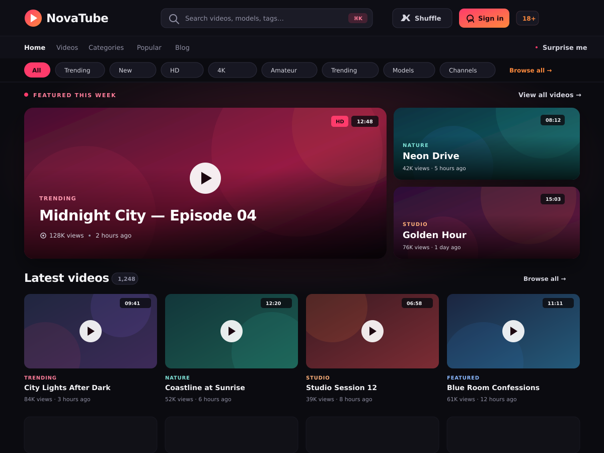

# NovaTube

A clean, minimal, feature-rich WordPress theme for tube sites. NovaTube pairs a dedicated video post type with an Astryx-inspired component system, a dark-first palette (with a light mode), taxonomy-driven discovery, AJAX loading, saved videos, instant search, and a configurable 18+ age gate.

[](novatube/screenshot.png)

*The NovaTube homepage: featured hero, category chips, and the latest video grid. [View full size](novatube/screenshot.png).*

## Contents

- [Overview](#overview)
- [Highlights](#highlights)
- [Requirements](#requirements)
- [Installation](#installation)
- [Setting up videos](#setting-up-videos)
- [Customizer reference](#customizer-reference)
- [Theme structure](#theme-structure)
- [Development](#development)
- [Packaging](#packaging)
- [Frequently asked questions](#frequently-asked-questions)
- [Credits](#credits)
- [Changelog](#changelog)
- [License](#license)

## Overview

NovaTube is built for sites where video is the product. It registers a `video` post type with its own categories, tags, and models, presents promoted content in a compact spotlight, and keeps browsing fast with a responsive grid and AJAX “Load more”.

The visual layer is a PHP-rendered `nt-` component library built on the vendored Astryx neutral tokens, Figtree font, and a dark-first palette with a user-switchable light mode. Everything is managed from the WordPress dashboard. The theme has no build step, no page-builder dependency, and no external JavaScript framework.

## Highlights

### Video-first content

- Dedicated `video` post type with categories, tags, and models.
- Three-card featured spotlight with a large lead video.
- Responsive video grid with AJAX “Load more”.
- Video pages with direct file, YouTube, Vimeo, and iframe player support.
- Reference-style single video layout: release details, description, trailer, preview gallery/lightbox, file specs, downloads, spare links, cast/categories/tags, related videos, and threaded comments.
- HD badges, duration labels, view counts, and five-star ratings.
- Taxonomy chips, related videos, and threaded comments.
- VideoObject structured data for search engines.

### Discovery and archives

- Video archive with Latest, Most viewed, Top rated, and Oldest sorting.
- Category, tag, model, author, date, search, and standard blog archives.
- Category chips beneath the header for quick filtering.
- Breadcrumbs, numbered pagination, and a random-video link.

### Engagement

- Five-star rating widget with one vote per browser, enforced by cookie.
- One-view-per-browser counter; editors do not inflate their own counts.
- Local “Saved videos” watchlist with a dedicated dialog.
- Instant search dialog with grouped results and keyboard navigation (`⌘/Ctrl + K` or `/`).
- Dark/light colour mode toggle, persisted on the device.
- Copy-link, X, Telegram, and email sharing actions.
- Accessible navigation, skip link, focus states, and keyboard support.

### Monetization and compliance

- Sanitized sidebar and below-player advertisement slots.
- Configurable 18+ age gate with custom copy and exit URL.
- Footer areas for legal pages, disclaimers, and social profiles.

### Customization

- Brand colors for the primary and secondary accents.
- Homepage controls for the spotlight, headings, popular section, chips, and videos per page.
- Age-gate copy and destination controls.
- Advertisement HTML fields for the sidebar, below-player, and homepage placements.
- Footer about text, disclaimer, copyright line, and social links.

## Requirements

| Requirement | Minimum |
| --- | --- |
| WordPress | 6.2 |
| PHP | 7.4 |
| Tested up to | WordPress 7.1 |

## Installation

1. Build or download `dist/novatube-1.0.0.zip`.
2. In WordPress, go to **Appearance → Themes → Add New → Upload Theme**.
3. Upload the ZIP, install it, and activate NovaTube.
4. Go to **Settings → Permalinks** and save once so the video archive and taxonomy URLs are registered.
5. Create a menu under **Appearance → Menus** and assign it to the **Primary Menu** location. A sensible fallback menu is shown until you do.
6. Optional: add widgets to the **Main Sidebar** location.

## Setting up videos

1. Go to **Videos → Add New**.
2. Add a title and, optionally, a description.
3. In the **Video Details** panel, paste one of the following into **Video embed URL or code**:

   | Source | What to paste |
   | --- | --- |
   | Direct video file | `https://example.com/clip.mp4` |
   | YouTube or Vimeo | The normal watch URL |
   | Player host | An iframe embed code |

   Scripts inside pasted embed codes are removed for security. If your player requires additional tags, extend the allowed HTML with the `novatube_embed_allowed_html` filter.

4. Set a featured image. It is used as the card thumbnail and video poster.
5. Add a duration as `12:34`, `1:02:03`, or a number of seconds.
6. Fill in the reference-style detail fields as needed:

   | Field | Format |
   | --- | --- |
   | Release date, site, resolution, bitrate, frame rate, audio | Plain text |
   | File name / file size | Plain text |
   | Trailer URL | A full `https://` URL |
   | Preview images | One image URL per line |
   | Download links | `Label | URL | Size`, one per line (a bare URL also works) |
   | Spare links | Same format as download links |

7. Choose video categories, tags, and models in the side panels.
8. Optionally tick **HD video** and **Feature in the homepage spotlight**.

Videos appear automatically on the homepage, the `/videos/` archive, and their taxonomy pages. The detail fields populate the single video page’s specs, previews, trailer, and download sections.

## Customizer reference

Open **Appearance → Customize → NovaTube Options**.

| Section | What you can change |
| --- | --- |
| Brand Colors | Primary and secondary accent colors |
| Homepage | Hero visibility and label, latest heading, top-rated section, category chips, videos per page |
| Age Gate | Enable or disable, heading, description, enter button label, exit URL |
| Advertisement Slots | Sidebar and below-player HTML |
| Footer & Social | About text, legal disclaimer, copyright line, X, Instagram, and Telegram links |

## Theme structure

```text
novatube/
├── assets/
│   ├── css/
│   │   ├── base.css
│   │   ├── components.css
│   │   ├── editor.css
│   │   ├── main.css           # legacy, not enqueued
│   │   └── templates.css
│   ├── img/
│   │   └── placeholder.svg
│   ├── js/
│   │   └── main.js
│   └── vendor/
│       └── astryx/            # core CSS, neutral theme, Figtree font
├── inc/
│   ├── ajax.php
│   ├── customizer.php
│   ├── meta-boxes.php
│   ├── post-types.php
│   ├── setup.php
│   ├── template-tags.php
│   └── video-meta.php
├── languages/
│   └── novatube.pot
├── template-parts/
│   ├── age-gate.php
│   ├── content-none.php
│   ├── hero.php
│   ├── post-card.php
│   └── video-card.php
├── 404.php
├── archive.php
├── comments.php
├── footer.php
├── front-page.php
├── functions.php
├── header.php
├── index.php
├── page.php
├── screenshot.png
├── search.php
├── searchform.php
├── sidebar.php
├── single-video.php
├── single.php
└── style.css
```

## Development

The theme has no build step. Edit PHP, CSS, and JavaScript directly and refresh the browser. Styles are layered as `base.css` (tokens, reset, layout, responsive), `components.css` (buttons, cards, dialogs, forms), and `templates.css` (home, single video, blog, comments). The vendor directory contains the compiled Astryx neutral theme and is loaded before the NovaTube layers.

Useful checks:

```bash
# Lint every PHP file
find novatube -name '*.php' -print0 | xargs -0 -n1 php -l

# Validate the translation template
msgfmt --check --output-file=/dev/null novatube/languages/novatube.pot
```

All user-facing strings use the `novatube` text domain. The translation template lives at `novatube/languages/novatube.pot`.

## Packaging

Build an installable ZIP from the repository root:

```bash
mkdir -p dist
zip -r dist/novatube-1.0.0.zip novatube -x '*.DS_Store' -x '__MACOSX/*'
```

The archive contains a top-level `novatube/` directory, which is the structure WordPress expects for theme uploads.

## Frequently asked questions

### Why is the video archive returning a 404?

Visit **Settings → Permalinks** and save once. The theme flushes rewrite rules on activation, but saving permalinks also repairs an existing install.

### How do I change the player size?

The player fills a 16:9 container capped by the theme content width. Use Additional CSS to adjust `.nt-player__ratio` or `.novatube-player` if needed.

### How do I add an ad network script?

Scripts are removed from ad fields on purpose. Load the network’s JavaScript through a small plugin or a child theme, then place the ad markup, such as an `<ins>` tag, in the Customizer field.

### How do I use a child theme?

Create a child theme that enqueues the parent stylesheet, then override templates and styles there. Because NovaTube has no build step, every CSS and JavaScript file is editable directly.

### Are ratings and views cached?

No. Ratings and view counts are stored as post meta. Views are counted once per browser per video using a cookie, and logged-in editors do not inflate their own counts.

## Credits

- Icons: inline SVG drawn for this theme, based on common interface metaphors.
- UI system: [Astryx](https://astryx.atmeta.com/components) core and neutral theme, vendored as compiled CSS under `assets/vendor/astryx/`.
- Fonts: Figtree from the Astryx neutral theme package, with a system fallback stack.
- Placeholder artwork: `assets/img/placeholder.svg`, original for this theme.

## Changelog

### 1.0.0

- Initial release.
- Clean `nt-` component layer built on Astryx neutral tokens, Figtree, dark/light modes.
- Reference-inspired homepage and single video page layouts.
- Video detail fields for release data, previews, specs, downloads, and spare links.
- Instant search, saved videos, live ratings, lightbox, and AJAX load more.

## License

NovaTube is licensed under the GNU General Public License v2 or later. See <https://www.gnu.org/licenses/gpl-2.0.html>.
